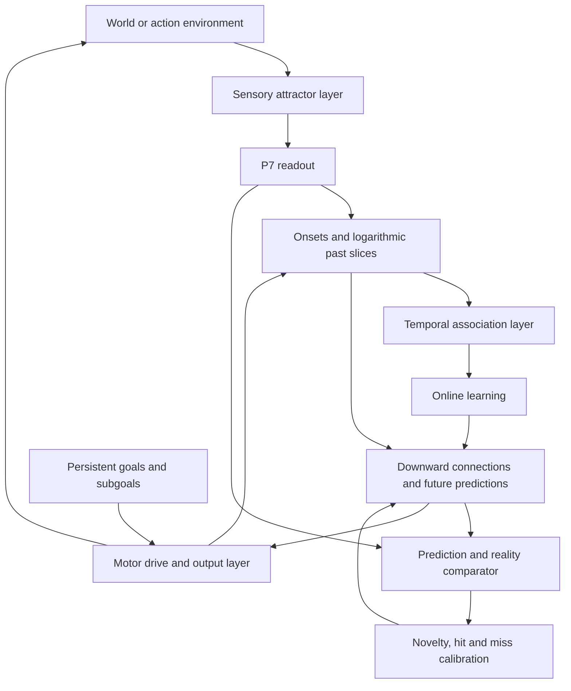

# Architecture

`bio-brain-v2` is a dependency-free Node.js ESM research implementation of
spiking attractor networks, temporal associations, prediction calibration,
and goal-directed actions. Node.js 20 or newer is required; run `npm test`.

The authoritative conceptual design is the
[multilayer architecture narrative](docs/multilayer-architecture-narrative.md).
This document maps that design to the current implementation. Milestone reports
and [SUPERVISION.md](SUPERVISION.md) record experimental decisions and acceptance
results; passing implementation tests does not imply behavioral acceptance.

## Neural dynamics

`src/core/` supplies reproducible randomness and state helpers.
`src/neuron/lif.mjs`, `src/synapse.mjs`, `src/stdp.mjs`, and `src/network.mjs`
implement neurons, receptor dynamics, sparse connectivity, excitatory plasticity,
and inhibitory plasticity. `src/checkpoint.mjs` persists resumable network state.

`src/layer.mjs` builds attractor layers from these primitives. Replicas share
topology while retaining independent noise; inhibitory learning separates
assemblies. `src/readout.mjs` measures attractor activation over 100 ms windows
using member participation rather than repeated-spike counts.

## Temporal memory and prediction

`src/unroll.mjs` converts newly active attractors into nine logarithmic past
columns. Column zero represents the immediate past; delayed columns have centers
from 100 ms through 12.8 s. Their inputs let a higher attractor layer learn
temporal relationships through simultaneous activation.

`src/downward.mjs` owns plastic downward connections and directed association
measurements. `src/predict.mjs` maintains future predictions with contributor
identity and arrival times, alongside a separate persistent goal row.
`src/learning.mjs` couples the rule layer to online learning. These bookkeeping
operations run between readout windows, outside the neural tick loop.

## Calibration and actions

`src/errors.mjs` compares reality with arriving predictions using novelty and
miss populations. `src/three-factor.mjs` creates connections from novelty,
reinforces matched predictions, and weakens unmatched predictions at their
deadlines. The current M11f pilot is documented in
[its report](docs/m11f-pilot.md), including failed criteria and unfinished work.

`src/goals.mjs` handles goal drive and bounded subgoal recursion.
`src/output.mjs` implements motor readout and execution; `src/io.mjs` connects
observations and efference copies to the shared feature interface.
`src/world.mjs` and `src/envs/actions.mjs` provide experimental environments.

## Repository layout and reproduction

| Path | Purpose |
| --- | --- |
| `src/` | Runtime modules and environment implementations |
| `verify/` | Deterministic checks and implementation regression suites |
| `experiments/` | Milestone training, probes, diagnostics, and reports |
| `docs/` | Design narrative, reuse map, calibration notes, and milestone findings |
| `README.md` | Usage and historical milestone results |
| `SUPERVISION.md` | Research decisions and experiment constraints |
| `out/`, `logs/` | Local generated artifacts, excluded from Git |

Run `npm test` for the verification suite. Run individual experiment scripts with
`node experiments/<script>.mjs`; inspect each script and its milestone report for
arguments and required cached artifacts. Some experiments depend on earlier
teacher checkpoints. Existing links into ignored `out/` refer to local artifacts
and will require those artifacts to be regenerated or distributed separately.
